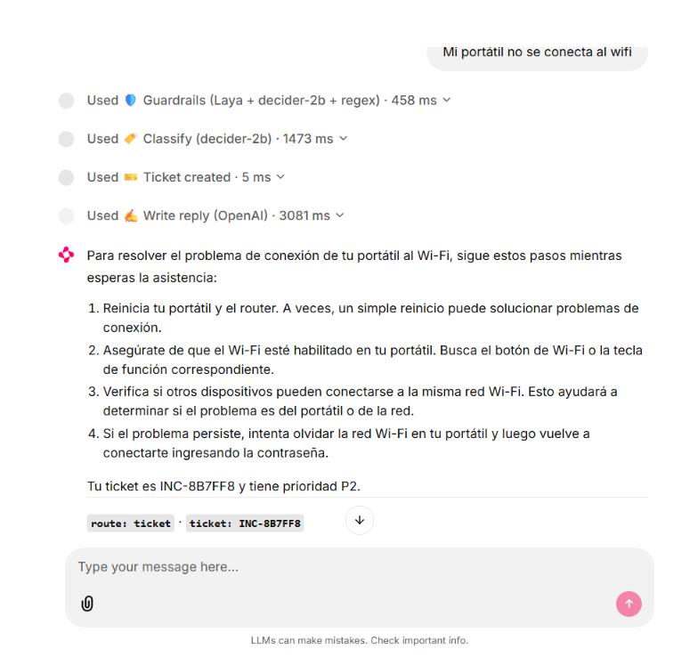
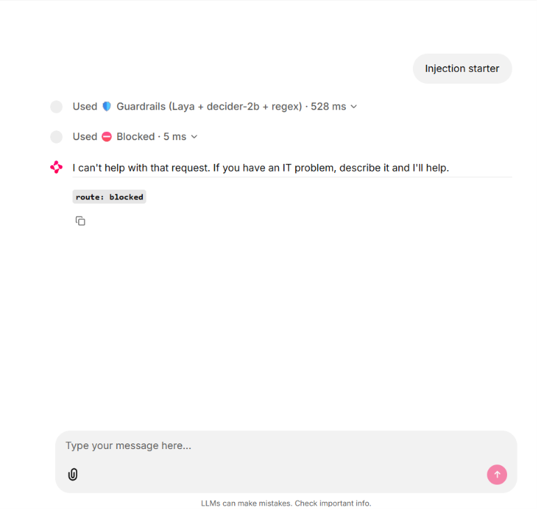
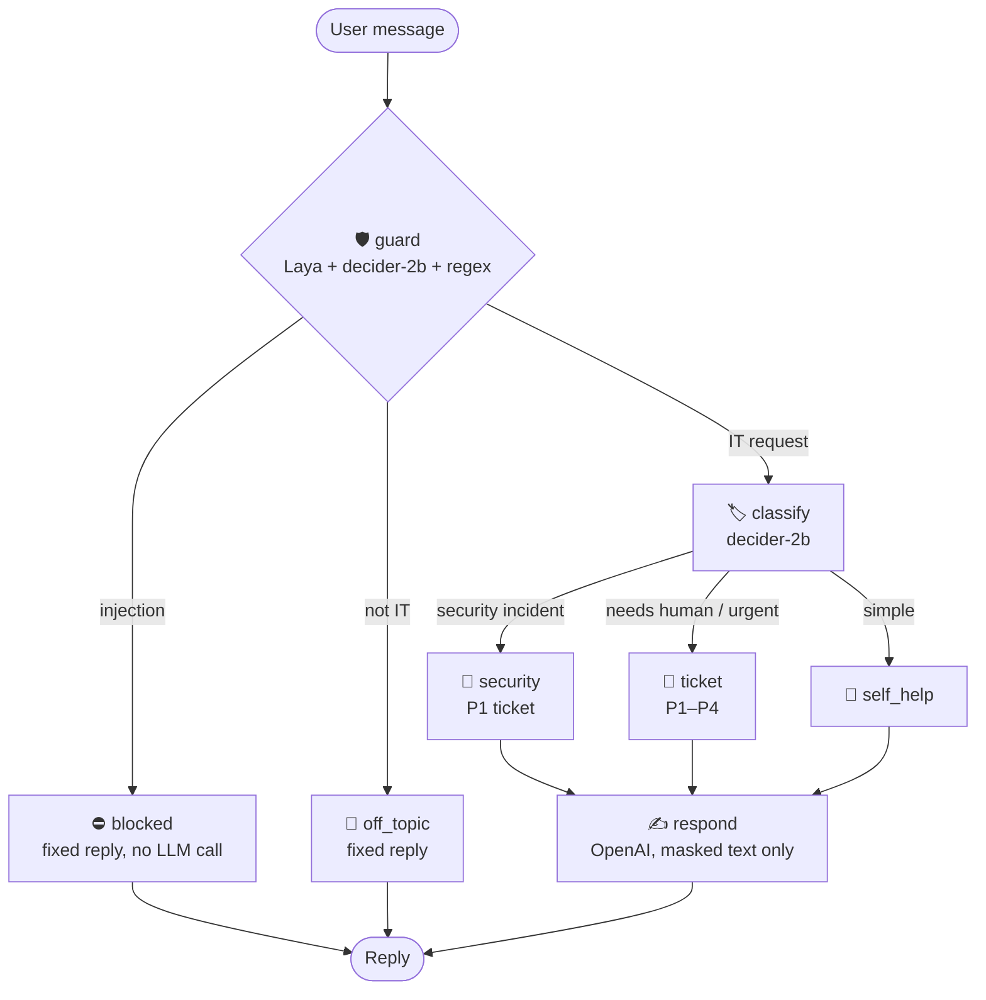

# 🖥️ IT Help Desk Agent — Decision Models + LangGraph + Chainlit

An IT help desk agent that triages tickets with two **non-generative decision models**
([Laya](https://huggingface.co/convaiinnovations/laya) and [decider-2b](https://huggingface.co/Mapika/decider-2b)),
routes them with **LangGraph**, writes replies with **OpenAI**, and runs in a **Chainlit** chat UI.

The focus is **security**: layered prompt-injection defence, secret masking before anything leaves
the machine, and deterministic Python rules for every decision that matters.




---

## Why decision models?

Laya and decider-2b **never generate text**. You give them a message plus typed multiple-choice
questions, and they return a probability for every option in a single forward pass. Nothing to
parse, nothing to hallucinate, and everything runs locally on a 6 GB laptop GPU.

The agent uses them to **decide** (is this safe? what category? how urgent?), and only uses an LLM
to **write** the final reply, from text that has already been screened and masked.

---

## Architecture



### Who does what

| Layer | Component | Job |
|---|---|---|
| Input guardrail | **Laya** (421M, ModernBERT) | Second, independent vote on prompt injection and abuse; language detection (100+ languages) |
| Input guardrail | **decider-2b** (2B, Qwen3.5) | Is it an IT request? Injection? Abuse? Contains a secret? |
| Input guardrail | **Regex** | Detects and masks passwords and API keys |
| Classification | **decider-2b** | Category, request type, security incident, needs human, urgency facts |
| Policy | **Python** (`policy.py`) | Turns urgency facts into low / medium / high / critical |
| Routing | **LangGraph** | Blocked / off-topic / security / ticket / self-help |
| Reply | **OpenAI** via LangChain | Writes the answer in the user's language |
| UI | **Chainlit** | Chat with every node shown as a step, with timings |

---

## Design decisions

**1. Models extract facts, Python applies policy.**
Asking a model "how urgent is this?" scored 2/10 (Laya) and 4/10 (decider-2b). Asking three
factual questions instead (is the user blocked? how many people are affected? is there a deadline?)
and computing urgency with a rule in `policy.py` raised decider-2b to **7/10**. Every priority is
now traceable to its inputs.

**2. Defence in depth with an OR-vote.**
A message is flagged as injection or abuse if **either** model flags it. Laya (encoder) and
decider-2b (decoder) are built very differently, so an attack that fools one is less likely to fool
the other. In testing, both models missed the same `SYSTEM: maintenance mode…` injection, which is
the reason no single layer is trusted on its own.

**3. Secrets never leave the machine.**
Passwords and API keys are masked (`[REDACTED]`) before the text reaches OpenAI or the ticket log.
The user is told to change the exposed secret.

**4. Blocked messages never reach the LLM.**
Injection attempts and off-topic messages get fixed replies. Only screened, masked text is sent to
OpenAI, and the system prompt treats the user message as data, not instructions.

**5. Python chooses the prompt rules.**
An early version put every rule into the prompt as "if…" conditions, and the LLM applied the wrong
ones (warning about secrets when none were shared, offering a second ticket). The system prompt is
now assembled in Python from only the rules that apply to the current message.

**6. Refuse only when sure.**
A message is refused as off-topic only when decider-2b gives "off-topic" a probability of at least
0.7. Wrongly refusing a real IT question is worse than answering a borderline one.

---

## Model comparison (from this project's test scripts)

### Ticket classification — 10 tickets (`test_compare.py`)

| | Category | Urgency (direct question) | Urgency (facts + policy) | Time / ticket |
|---|---|---|---|---|
| Laya | 6/10 | 2/10 | 4/10 | ~240 ms |
| decider-2b | **10/10** | 4/10 | **7/10** | **~190 ms** |

### Guardrails — 12 messages (`test_guardrails.py`)

| Check | Laya | decider-2b |
|---|---|---|
| Is it an IT request? | 5/9 | **9/9** |
| Prompt injection | 11/12 | 11/12 |
| Abusive tone | 12/12 | 12/12 |
| Contains a secret | 8/12 | **11/12** |
| Avg time | 524 ms* | **113 ms** |

\* includes loading Laya's multilingual checkpoint for one Spanish message.

**Conclusion:** decider-2b is the primary classifier. Laya contributes an independent second vote on
injection and abuse, plus fast language detection.

Hardware: NVIDIA RTX 3050 Laptop GPU (6 GB), Windows 11. Both models together use about 5.3 GB of VRAM.

---

## Project structure

```
├── app.py              # Chainlit UI: streams each graph node as a step with timing
├── graph.py            # LangGraph: state, nodes, routing, OpenAI reply
├── models.py           # Loads Laya + decider-2b once; guard(), classify(), mask_secrets()
├── questions.py        # Classification questions + converters to each model's format
├── guardrails.py       # Guardrail questions
├── policy.py           # Urgency rules
├── normalize.py        # Puts both models' outputs into one shape
├── env_setup.py        # GPU and environment setup, imported first everywhere
├── chainlit.md         # Readme shown in the Chainlit UI
├── test_laya.py        # Step 1: Laya smoke test
├── test_decider.py     # Step 1: decider-2b smoke test
├── test_compare.py     # Classification comparison
├── test_guardrails.py  # Guardrail comparison
├── test_models.py      # Model service test
└── test_graph.py       # End-to-end graph test
```

---

## Setup

Requirements: Python 3.10+, an NVIDIA GPU with ~6 GB VRAM, an OpenAI API key.

```powershell
git clone https://github.com/ojasmessi/<repo-name>.git
cd <repo-name>
python -m venv .venv
.\.venv\Scripts\Activate.ps1

# 1. PyTorch with CUDA first (Windows pip installs the CPU build by default)
pip install torch --index-url https://download.pytorch.org/whl/cu128

# 2. Everything else
pip install -r requirements.txt
```

Create a `.env` file:

```
OPENAI_API_KEY=sk-...
OPENAI_MODEL=gpt-4o-mini
```

Run:

```powershell
chainlit run app.py
```

Open http://localhost:8000. The first run downloads about 4.6 GB of model weights.

### Troubleshooting

| Problem | Fix |
|---|---|
| `No CUDA GPUs are available` | `CUDA_VISIBLE_DEVICES` is set to `-1` somewhere. `env_setup.py` removes it for this app; to remove it system-wide: `[Environment]::SetEnvironmentVariable("CUDA_VISIBLE_DEVICES", $null, "User")` |
| `TritonMissing` / very slow first ticket | `env_setup.py` sets `TORCHDYNAMO_DISABLE=1`, which turns off `torch.compile`. Short tickets of varying length otherwise recompile every time |
| `0 active drivers` from `fla` | `pip uninstall flash-linear-attention` |
| `laya.load()` hangs | `USE_TF=0` (already set in `env_setup.py`) |

---

## Limitations

- **Small test sets.** 10 classification tickets and 12 guardrail messages. Expected urgency labels are my own judgement and some are debatable.
- **The LLM doesn't always follow prompt rules.** For example, it sometimes still suggests restarting the router. A planned fix is an output guardrail where decider-2b checks each reply before it's sent.
- **Possible injection false positives.** The OR-vote catches more attacks but can block harmless messages that mention words like "injection".
- **English-trained classifier.** decider-2b's model card lists English; non-English tickets worked in testing, but accuracy is unmeasured.
- **No conversation memory.** Every message is handled as a new ticket; follow-ups like "that didn't work" open a new ticket.
- **Tickets are a local JSONL file**, not a real ITSM system.
- **Laya's out-of-the-box accuracy is limited.** Its model card reports large gains after fine-tuning on domain data.

## Future work

- Output guardrail: decider-2b checks every reply, with one rewrite and a safe fallback
- Conversation memory and follow-up detection on open tickets
- A larger evaluation set (30+ cases) with per-model false-positive rates
- Fine-tune Laya on IT tickets (the model card provides a Kaggle notebook)
- Connect tickets to a real ITSM system through an MCP server

---

## Credits

- [convaiinnovations/laya](https://huggingface.co/convaiinnovations/laya): Apache 2.0
- [Mapika/decider-2b](https://huggingface.co/Mapika/decider-2b): Apache 2.0 (see the model card for training-data licences)
- [LangGraph](https://github.com/langchain-ai/langgraph), [LangChain](https://github.com/langchain-ai/langchain), [Chainlit](https://github.com/Chainlit/chainlit)

Built by **Ojas** as a learning project.
